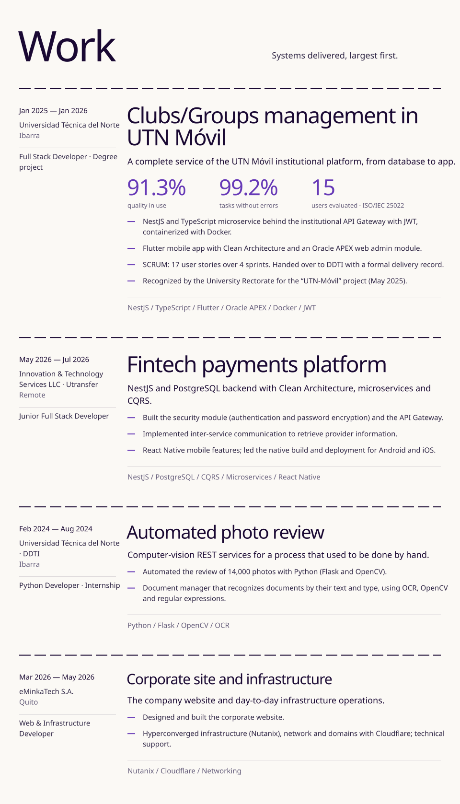
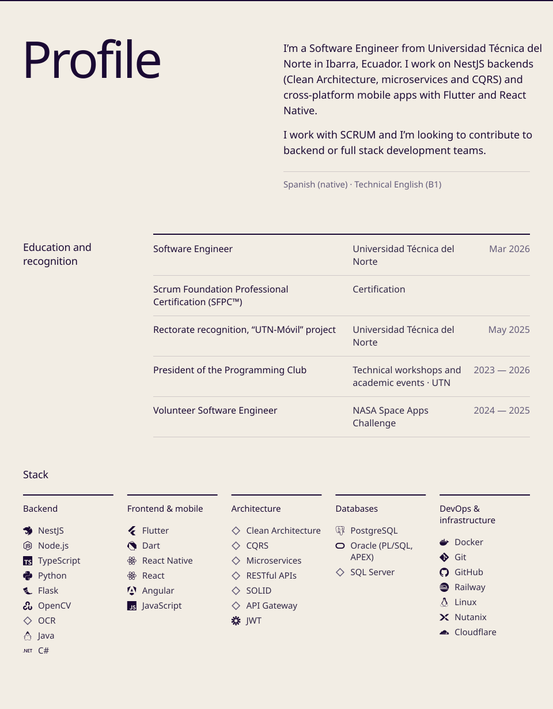
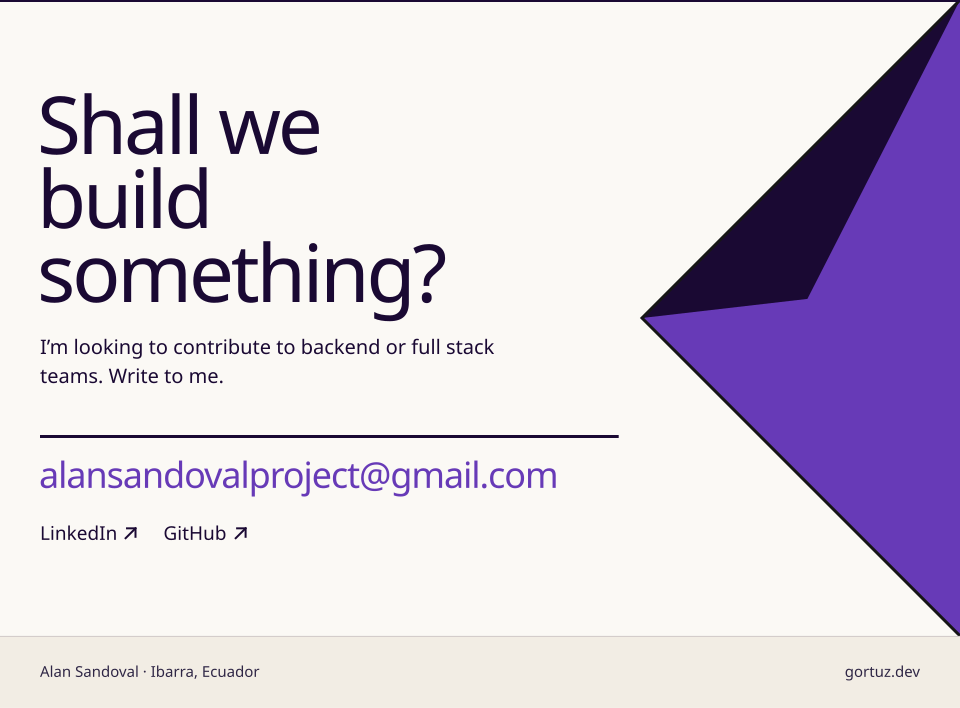

<b>EN</b> · <a href="README.md">ES</a>

<a href="https://gortuz.dev/en/">
  <picture>
    <source media="(prefers-color-scheme: dark)" srcset="assets/hero-en-dark.svg">
    
  </picture>
</a>

<a href="https://gortuz.dev/en/">
  <picture>
    <source media="(prefers-color-scheme: dark)" srcset="assets/work-en-dark.svg">
    
  </picture>
</a>

<a href="https://gortuz.dev/en/">
  <picture>
    <source media="(prefers-color-scheme: dark)" srcset="assets/profile-en-dark.svg">
    
  </picture>
</a>

<a href="mailto:alansandovalproject@gmail.com">
  <picture>
    <source media="(prefers-color-scheme: dark)" srcset="assets/contact-en-dark.svg">
    
  </picture>
</a>

<a href="mailto:alansandovalproject@gmail.com">alansandovalproject@gmail.com</a> · <a href="https://www.linkedin.com/in/adsandovalp/">LinkedIn ↗</a> · <a href="https://gortuz.dev/en/">gortuz.dev ↗</a>

